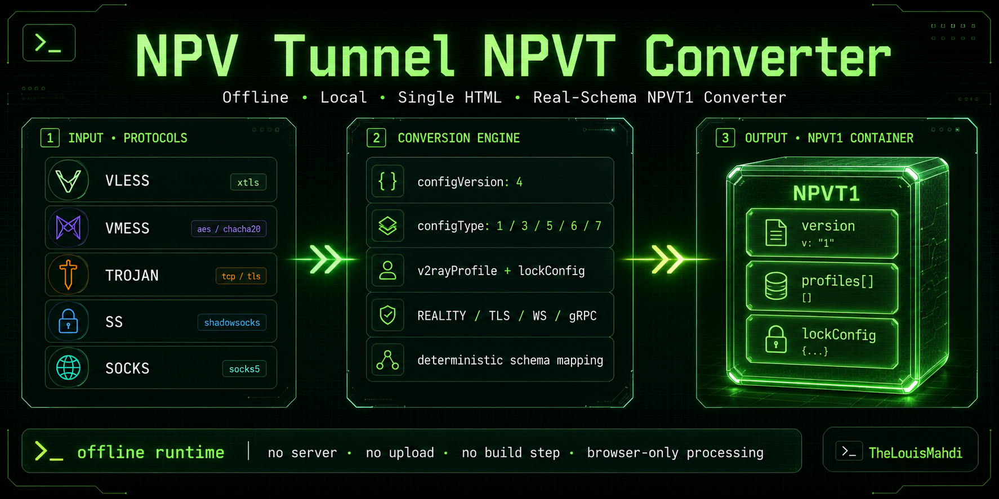
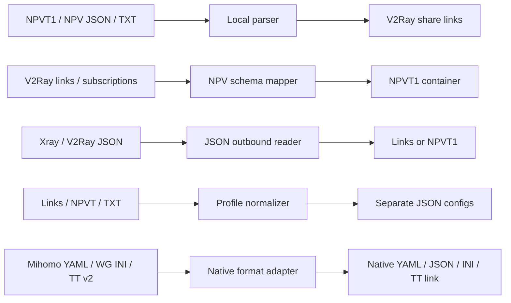
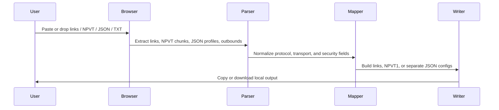

<div align="center">


<br />
<br />



# NPV Tunnel NPVT Converter

<strong>Offline · Local · Single HTML · NPVT1 · V2Ray Links · Xray JSON Toolkit</strong>

<br><br>

<a href="https://github.com/TheLouisMahdi/npvt-terminal-converter/archive/refs/heads/main.zip">
  
</a>
<a href="https://github.com/TheLouisMahdi/npvt-terminal-converter/raw/main/Index.html">
  
</a>


<h2>
  <a href="https://github.com/TheLouisMahdi/npvt-terminal-converter/archive/refs/heads/main.zip">Download for mobile</a>
</h2>

<p>
  Mobile browsers may open raw HTML as text. Use the ZIP download above, then extract and open <code>Index.html</code> locally.
</p>

</div>

---

## Overview

**NPV Tunnel NPVT Converter** is a browser-only conversion toolkit for moving configurations between NPV Tunnel `.npvt` containers, V2Ray-style share links, and Xray/V2Ray JSON profiles.

The project is designed as a single portable HTML file. It does not require installation, bundling, a backend server, external APIs, or upload endpoints. All parsing, decoding, mapping, JSON generation, NPVT1 building, and file output happen locally inside the browser runtime.

The current engine is based on real NPVT1 exports and expanded with a bidirectional JSON toolkit. It understands NPV-style profile wrappers, `v2rayProfile`, embedded `v2rayJson`, Xray/V2Ray `outbounds`, `streamSettings`, `vnext`, `servers`, WebSocket metadata, TLS/REALITY fields, and NPVT1 chunk layout.

---


## What's new in the 2026 converter

The original NPVT1 and V2Ray converter has been expanded with protocol adapters, native formats, core validation and a mobile-friendly workspace. All conversion still happens locally in one HTML file.

| Family | New functionality | Supported scope |
| --- | --- | --- |
| Xray / VLESS | XHTTP mode, host, path, extra, xmux, downloadSettings, modern outbound settings, post-quantum encryption fields | URI and JSON where representable; not unsupported NPVT1 |
| sing-box | AnyTLS, Hysteria2 Gecko/Realm/port hopping/ECH, TUIC | Standard link and native JSON conversions; advanced options remain native |
| Shadowsocks | SIP002, SIP022/SS2022, SIP003 plugin options | Basic share URIs and native sing-box JSON with preservation checks |
| Mihomo | YAML and JSON native-format mapping | Snell, TrustTunnel, ShadowQUIC, Mieru, WireGuard/AmneziaWG |
| TrustTunnel | TLV version 2 deep-link codec | tt://? round trips; Mihomo only for losslessly representable links |
| WireGuard / AWG | Client INI/YAML/JSON; version 3/3.1 safeguards | Verified client fields, multi-peer data and header padding checks |
| UI | Six-section workflow navigation, wide native editor, file open/copy/download, mobile layout | No external runtime dependencies |
| Maintenance | Upstream changes monitored across 14 repositories | Daily GitHub issue reporting; no automatic merging of parser changes |

### Conversion workspace

| Section | Input | Output |
| --- | --- | --- |
| 01 NPVT to Links | NPVT1 files, JSON, text, subscriptions | Extracted share links |
| 02 Links to NPVT | Validated legacy NPVT-compatible links | NPVT1 container / profile JSON |
| 03 JSON to Links | Xray, sing-box and NPV JSON | Share links with conversion warnings |
| 04 Links to JSON | Proxy links, NPVT1, subscriptions | Xray or sing-box JSON |
| 05 Native formats | Mihomo YAML/JSON, WireGuard client INI, TT version 2 links | Mihomo YAML, JSON, WireGuard INI, TT link |
| 06 Results | Extracted profiles | Table and exports |

**Important:** Native config support does not imply universal share-link or NPVT1 encoding. Advanced YAML tags, aliases, anchors, folded blocks and templates are unsupported in the lightweight offline parser. Unmappable fields are reported instead of being silently removed.

Full boundaries: [Native format adapters](docs/NATIVE_FORMATS.md), [Core compatibility](docs/CORE_COMPAT_2026_Q3.md), [Maintenance](docs/MAINTENANCE.md).

---

## Download

### Recommended for Android / iOS

Download the repository ZIP. This forces a real file download on mobile browsers:

```text
https://github.com/TheLouisMahdi/npvt-terminal-converter/archive/refs/heads/main.zip
```

After download:

1. Extract the ZIP file.
2. Open the extracted folder.
3. Tap `Index.html`.
4. Use the converter locally in your browser.

### Direct HTML Link

Desktop browsers usually handle the direct HTML file correctly:

```text
https://github.com/TheLouisMahdi/npvt-terminal-converter/raw/main/Index.html
```

On some mobile browsers, this link may display the source code as text instead of downloading it. Use the ZIP link above if that happens.

---

## Conversion Workflows



<div align="center">


</div>

The app includes five conversion workspaces plus a results table:

| Panel | Input | Output |
|---|---|---|
| **NPVT1 / NPV JSON → V2Ray Links** | `.npvt`, `NPVT1`, NPV-style JSON, text exports, Base64 subscriptions | Clean share links |
| **V2Ray Links → NPVT1 / NPV JSON** | `vless://`, `vmess://`, `trojan://`, `ss://`, `socks://`, JSON, mixed text, subscriptions | Real-schema `.npvt` container and profile JSON |
| **Xray / V2Ray JSON → Links / NPVT** | Full Xray config, `outbounds[]`, NPV `v2rayProfile`, profile arrays, mixed JSON | Short share links or NPVT1 output |
| **Links / NPVT / TXT → Separate JSON Configs** | One link, many links, `.npvt`, `.txt`, subscription, mixed text | One standalone JSON config per profile in a TXT output |
| **Mihomo / TrustTunnel / WireGuard native formats** | YAML, JSON, WG/AWG INI, TT deep link | Native YAML, JSON, INI, TT deep link where safe |

---

## Supported Protocol Families

**Supported** below means the documented mapping is available, not that every option or live connection has been tested. Core checks validate representative generated configurations.

| Protocol | Share/deep link | Native output | NPVT1 export | Core test |
| --- | --- | --- | --- | --- |
| VLESS | vless:// import/export, with restrictions | Xray JSON | Legacy subset only | Xray |
| VMess | vmess:// Base64 import/export | Xray JSON | Legacy subset | Xray |
| Trojan | trojan:// import/export | Xray JSON | Legacy subset | Xray |
| Shadowsocks / SS2022 | ss://, SIP002/022 and supported SIP003 plugins | Xray or sing-box JSON | Plain legacy subset; plugins excluded | Xray / sing-box |
| SOCKS | socks:// basic credentials | Xray JSON | Basic legacy subset | Xray |
| AnyTLS | anytls:// basic settings | sing-box JSON | No | sing-box |
| Hysteria2 (Gecko/Realm/ECH) | hy2://, hysteria2:// and Realm variants, with restrictions | sing-box JSON | No | sing-box (Gecko/Realm fixtures) |
| TUIC | tuic:// import | sing-box JSON | No | sing-box |
| TrustTunnel | tt://? v2 TLV codec | Mihomo YAML/JSON when lossless | No | Mihomo |
| Snell | No universal share URI | Mihomo YAML/JSON | No | Mihomo |
| ShadowQUIC | No verified general URI mapping | Mihomo YAML/JSON | No | Mihomo |
| Mieru | No verified general URI mapping | Mihomo YAML/JSON | No | Mihomo |
| WireGuard / AmneziaWG 3.1 | Client INI (not generic wireguard:// links) | Mihomo YAML/JSON and INI | No | Mihomo |
| Base64 subscriptions | Scans supported links | Extracted profiles | Eligible links only | Unit/browser |
| Juicity / NaiveProxy / MASQUE | No complete adapter | Not implemented | No | Not tested |

Only the documented **subset** of Mihomo YAML is parsed. Complex anchors, aliases and templates are rejected; use a full YAML parser for those inputs. Unknown transport and security options are rejected where they cannot be represented without loss.

---

## Hysteria2 2026 compatibility

The converter now recognizes the documented Hysteria2 / HY2 URI form, including Gecko obfuscation and UDP port hopping. Port ranges such as `443,5000-6000` map to sing-box's native `server_ports: ["443:443", "5000:6000"]` representation. The reverse route maps the ranges back to standard Hysteria2 URI syntax.

The documented `hysteria2+realm://` and `hysteria2+realm+http://` schemes map to sing-box 1.14+ `realm` objects. A Realm token is **not** the Hysteria authentication password. `auth` is read separately, and the realm name and repeated STUN addresses are mapped explicitly. For a valid sing-box Realm export, the input URI must specify STUN servers.

**ECH conversion:** Hysteria URI public ECHConfigList Base64 is wrapped as a sing-box PEM `ECH CONFIGS` line array. Reverse conversion is supported for an inline public ECH PEM block only. The mapping validates the outer ECHConfigList length, but does not verify every HPKE or server handshake parameter.

**Lossless conversion limit:** Hysteria `pinSHA256` is a hash of the full certificate, not a public-key pin. It is not converted into a different pin type.

Realm `lport`, Gecko packet-size tuning, `hop_interval_max`, `bbr_profile`, additional TLS options, and other non-URI sing-box settings stay in full JSON rather than being silently flattened.

Sources:
- [Hysteria2 official URI scheme](https://v2.hysteria.network/docs/developers/URI-Scheme/)
- [sing-box Hysteria2 outbound schema](https://sing-box.sagernet.org/configuration/outbound/hysteria2/)
- [sing-box TLS and ECH schema](https://sing-box.sagernet.org/configuration/shared/tls/)

Compatibility tests: `node --test tests/*.test.cjs`. External client/server interoperability remains unverified by this test suite.

---

## VLESS Encryption and XHTTP (2026)

The Xray JSON converter accepts both legacy `settings.vnext[].users[]` and the current `settings.address / port / id / encryption` outbound form. Opaque VLESS Post-Quantum Encryption strings are preserved verbatim in links and generated Xray JSON (they are **not** regenerated or cryptographically validated by this converter).

XHTTP links support `type=xhttp`, `host`, `path`, `mode` (`auto`, `packet-up`, `stream-up`, `stream-one`), and URL-encoded `extra` JSON for `xmux` and `downloadSettings`. `extra` is supported for this converter's round-trip representation; other clients may not understand the same share URI extension, so prefer **native Xray JSON** for maximum compatibility. Unrecognized native XHTTP fields block lossy link generation while preserving the complete source in the full JSON export path.

**NPVT compatibility:** XHTTP and post-quantum VLESS Encryption are **not** exported into NPVT1 until verified with genuine NPV Tunnel imports. The regular VLESS legacy path remains available.

Sources:
- [Official current Xray VLESS settings](https://xtls.github.io/en/config/outbounds/vless.html)
- [Xray XHTTP transport](https://xtls.github.io/en/config/transports/xhttp.html)
- [Official XHTTP upstream/downstream discussion](https://github.com/XTLS/Xray-core/discussions/4113)

---

## October 2026 core compatibility review

A dated comparison of Xray-core, sing-box, Mihomo, V2Fly and Hysteria releases is available in [the Q3 2026 compatibility matrix](docs/CORE_COMPAT_2026_Q3.md). Current automated checks cover sing-box 1.14.3 and Xray 26.7.28 plus 26.10.10 preview, using official Core binaries. A passing config check validates a selected JSON fixture, not every supported server or live handshake.

Shadowsocks 2022 URIs follow SIP022 percent-encoded credentials. SIP003 plugin links can export native sing-box JSON when their plugin is supported. They cannot be silently downgraded to plain Shadowsocks or assumed compatible with NPVT1. Unknown protocol types remain native-only until a documented share format and tests are provided.

---

## NetMod (.nm) and NPV Tunnel (.npvs) imports

The native-format file picker accepts encrypted configuration files **locally**, without uploading or logging them:

| Input | Status | Output |
| --- | --- | --- |
| NetMod Syna `.nm` | AES-128-ECB/PKCS#7 decoding for three published legacy key generations | Original decrypted NetMod JSON; SSH, Proxy, SNI, Payload and policy fields retained |
| NPV Tunnel `.npvs` binary v5 | Header, unlock method, and encrypted length detection | Actionable status only; no decrypted config until the authorized creator passphrase or required key is available |
| Other NPVS generations | Not implemented | Explicit version or malformed-file error |

**Important:** The NetMod sample uses SSH/Proxy definitions, not a V2Ray configuration. The converter preserves those fields as NetMod JSON rather than inventing a VLESS/Trojan link. The sample NPVS v5 uses passphrase-based PBKDF2-HMAC-SHA256 with 600,000 iterations and authenticated encrypted fields; this version of the panel does **not** claim to decrypt it without the actual creator's passphrase.

To use: open workflow **05 Native formats**, select the local `.nm` file, and copy or download the recovered JSON. Selecting a `.npvs` file checks its envelope and explains why the content remains locked. Source files and decrypted output are **never added to GitHub test fixtures**.

Implementation tests use only artificial NetMod payloads and synthetic NPVS headers. They do not publish uploaded configurations or credential material.

Related formats and implementation notes: [Native formats](docs/NATIVE_FORMATS.md). A third-party reference implementation is [Pantegnos](https://github.com/FrontierTM/Pantegnos) (AGPL-3.0); no source code or assets from that project are incorporated.

---

## Native Mihomo YAML, TrustTunnel links, and AmneziaWG

The offline HTML app now includes a **Mihomo / Clash YAML and AmneziaWG** section. It handles native Snell, TrustTunnel, ShadowQUIC, Mieru, and WireGuard/AmneziaWG v3.1 config nodes through YAML/JSON conversion. It also supports WireGuard client INI import/export and TrustTunnel official `tt://?` v2 binary deep-link decoding/encoding.

These adapters **preserve native protocol types** and reject unsupported fields rather than fabricating VLESS or NPVT links. The YAML reader supports plain mappings and sequences; advanced YAML anchors, tags, and block scalars are explicitly unsupported. Validity is checked with `mihomo -t` on representative samples, but real handshakes still need live testing.

Detailed support boundaries: [Native format adapters](docs/NATIVE_FORMATS.md).

---

## Protocol compatibility and tests

The converter supports standard [AnyTLS share URIs](https://github.com/anytls/anytls-go/blob/main/docs/uri_scheme.md) with password, server, port, SNI, and insecure TLS settings. AnyTLS link inputs export as native sing-box JSON. Basic sing-box AnyTLS outbounds can export to standard share URIs.

**NPVT1 is not a universal proxy container.** AnyTLS, Hysteria2, TUIC and other non-NPV protocols cannot be exported as NPVT1 without a verified target-client schema. The JSON-to-NPVT path skips such profiles and reports the omission instead of silently mislabeling them.

Session tuning, advanced TLS fields, nested proxy chains and other configuration features without a standard URI representation are not silently flattened into links. Preserve the original JSON when these fields matter. A supported share link does not imply that all fields of an arbitrary full configuration will survive conversion.

Protocol regressions run with Node.js 22:

```sh
node --test tests/*.test.cjs
```

The GitHub Actions workflow runs these tests on pull requests. They check deterministic conversion behavior; actual NPV Tunnel and upstream server interoperability still requires manual integration testing.

---

## NPVT1 Container Layout

The converter writes the observed three-part NPVT1 structure:

```text
NPVT1
<encrypted_version_chunk>,<encrypted_profile_array_chunk>,<encrypted_lock_config_chunk>
```

After local decoding, the logical structure is:

```text
chunk 1 -> "1"
chunk 2 -> JSON array of NPV-style profile wrappers
chunk 3 -> lockConfig JSON
```

A generated profile follows this structural model:

```json
{
  "name": "Profile name",
  "address": "server:port",
  "type": "V2RAY",
  "v2rayProfile": {
    "configVersion": 4,
    "configType": 5,
    "subscriptionId": "",
    "addedTime": 1780000000000,
    "remarks": "Profile name",
    "server": "example.com",
    "serverPort": "443",
    "password": "uuid-or-password",
    "network": "ws",
    "security": "tls",
    "v2rayJson": "",
    "persistJson": true
  },
  "lockConfig": {
    "version": 1,
    "isLocked": true,
    "password": "",
    "onlyMobileNetwork": false,
    "blockRootedAndJailbroken": true,
    "onlyOfficialStores": false,
    "expiryDate": "",
    "deviceIds": "",
    "message": "",
    "customServerMessage": ""
  }
}
```

---

## JSON Toolkit

The JSON toolkit is designed for real exported configs, not only ideal examples. It can read full Xray/V2Ray config files, profile arrays, NPV wrappers, and embedded NPV JSON strings.

### JSON input models

Supported JSON shapes include:

```json
{
  "outbounds": [
    {
      "tag": "proxy",
      "protocol": "vless",
      "settings": {},
      "streamSettings": {}
    }
  ]
}
```

```json
{
  "name": "Profile name",
  "type": "V2RAY",
  "v2rayProfile": {
    "remarks": "Profile name",
    "server": "example.com",
    "serverPort": "443",
    "network": "ws",
    "security": "tls",
    "v2rayJson": "{...}",
    "persistJson": false
  }
}
```

```json
[
  { "v2rayProfile": { "configType": 5 } },
  { "v2rayProfile": { "configType": 6 } }
]
```

### JSON output model

The reverse JSON exporter generates one standalone Xray/V2Ray-style JSON config per profile. The TXT output separates configs with a blank line so each profile remains easy to copy, inspect, or save individually.

Output is designed around this structure:

```json
{
  "log": {},
  "dns": {},
  "inbounds": [],
  "outbounds": [
    {
      "tag": "proxy",
      "protocol": "trojan",
      "settings": {},
      "streamSettings": {}
    }
  ],
  "routing": {}
}
```

---

## Computable Mapping Rules

The conversion engine uses deterministic mapping rules so each link, JSON outbound, or NPV profile becomes a predictable normalized profile.

### Protocol to `configType`

| Effective protocol | `configType` | Meaning |
|---|---:|---|
| VMess | `1` | VMess profile |
| Shadowsocks | `3` | Shadowsocks profile |
| VLESS | `5` | VLESS profile |
| Trojan | `6` | Trojan profile |
| SOCKS | `7` | SOCKS profile |

### VLESS Non-UUID Handling

Some public links use `vless://` syntax with a non-UUID user field, for example:

```text
vless://humanity@example.com:443?security=tls&type=ws
```

The converter handles this case as a compatibility rule:

```text
vless:// + non-UUID user id -> Trojan-style NPV profile
```

This rule improves compatibility with real NPV imports where non-UUID VLESS-style links may be represented as Trojan-like profiles internally.

---

## Transport Preservation

The converter preserves connection-critical fields instead of flattening or discarding them.

| Layer | Preserved fields |
|---|---|
| TCP / RAW | `headerType`, `security`, `sni`, `alpn`, `flow` |
| WebSocket | `path`, `host`, `headers.Host`, `security`, `sni`, `alpn`, `allowInsecure` |
| gRPC | `serviceName`, `authority`, `mode`, `xhttpMode` |
| TLS | `sni`, `serverName`, `alpn`, `fingerprint`, `allowInsecure` |
| REALITY | `pbk`, `publicKey`, `sid`, `shortId`, `spx`, `spiderX`, `fp`, `sni`, `flow`, `allowInsecure` |

The transport mapper follows the same layered idea used by Xray-style configurations: protocol identity, network transport, and transport security are treated as separate fields that must remain compatible with each other.

### WebSocket host preservation

For WebSocket-based profiles, `host` is treated as the WebSocket Host header, not only as the server address. This is important for CDN-style profiles where the connection may fail or show no ping if the WebSocket host header is dropped.

---

## REALITY and XTLS Vision Mapping

For VLESS REALITY links and JSON outbounds, URI parameters and JSON fields are mapped into Xray-style stream settings before being embedded into the NPV profile.

| Link parameter | JSON field | Internal meaning |
|---|---|---|
| `security=reality` | `streamSettings.security` | Enables REALITY transport security |
| `pbk` | `realitySettings.publicKey` | REALITY public key |
| `sid` | `realitySettings.shortId` | REALITY short ID |
| `spx` | `realitySettings.spiderX` | REALITY spiderX |
| `fp` | `realitySettings.fingerprint` | Client fingerprint |
| `sni` | `realitySettings.serverName` | Server name |
| `flow=xtls-rprx-vision` | `settings.vnext[].users[].flow` | VLESS flow control |

REALITY and flow-sensitive profiles may be stored with a full `v2rayJson` representation because these profiles are sensitive to stream structure, flow, security, and transport details.

---

## Field-Based vs JSON-Based Storage

The engine chooses between field-based and JSON-based profile storage depending on profile complexity.

| Storage mode | Used for | Reason |
|---|---|---|
| `persistJson: true` | Simple field-readable profiles such as VLESS WS/TLS, gRPC, and compatible Trojan WS/TLS exports | Keeps the NPV profile clean and close to real NPV exports |
| `persistJson: false` | REALITY, VMess, TCP-sensitive, or structure-sensitive profiles | Preserves full outbound/inbound JSON structure |

This gives simple profiles a compact NPV representation while protecting complex profiles from losing important stream settings.

---

## Local Runtime Design



The interface has direct keyboard-accessible links to six workflows, including the wide native workspace and results table. Native inputs support file selection, local download, copy and explicit error status.

---

## Feature Matrix

| Feature | Status |
|---|---:|
| Single HTML app | Complete |
| Offline browser runtime | Complete |
| V2Ray link extraction | Complete |
| NPVT1 three-chunk writer | Complete |
| NPVT1 profile-array reader | Complete |
| Xray/V2Ray JSON import | Complete |
| JSON to share links | Complete |
| JSON to NPVT1 | Complete |
| Links / NPVT / TXT to separated JSON configs | Complete |
| VLESS TLS / WS mapping | Complete |
| VLESS REALITY mapping | Complete |
| VMess parser | Complete |
| Trojan parser | Complete |
| Trojan WS/TLS field-based export compatibility | Complete |
| Shadowsocks SIP002 parser | Supported |
| SOCKS parser | Supported |
| WebSocket Host header preservation | Complete |
| Base64 subscription scan | Complete |
| Profile JSON export | Complete |
| Duplicate link filtering | Complete |
| Mihomo native YAML / JSON mapping | Supported for documented node subset |
| TrustTunnel v2 binary deep links | Supported with conservative lossless mapping |
| Snell / ShadowQUIC / Mieru | Mihomo native format support, not arbitrary share URIs |
| WireGuard / AmneziaWG 3.1 | Supported client INI, YAML and JSON fields |
| Native browser file open, copy and download | Supported; 1 MB file limit |
| Core CI validation | Xray, sing-box and Mihomo config fixtures |
| Responsive UI browser smoke | Automated Chromium desktop and mobile |
| Live client/server handshakes | Not tested |
| Server-side sync | Not included by design |

---

## Usage

### Convert NPVT / NPV JSON / TXT to V2Ray links

1. Open `Index.html` in a browser.
2. Drop or choose `.npvt`, `.json`, `.txt`, or subscription files.
3. Extract profile data locally.
4. Copy or download the generated share links.

### Convert V2Ray links to NPVT

1. Open `Index.html` in a browser.
2. Paste supported V2Ray links into the V2Ray-to-NPVT panel.
3. Click **Build NPVT**.
4. Download the generated `.npvt` file.
5. Import it into NPV Tunnel.

Example input:

```text
vless://uuid@example.com:443?security=tls&type=ws&host=example.com&path=%2Fws&sni=example.com#Example
```

### Convert JSON to links or NPVT

1. Paste a full Xray/V2Ray JSON config, an NPV `v2rayProfile`, or a profile array into the JSON panel.
2. Click **JSON → Links** for shorter share links.
3. Click **JSON → NPVT** for a direct NPVT1 output.
4. Copy or download the local output.

### Convert links / NPVT / TXT to separated JSON configs

1. Paste one link, multiple links, a subscription, or mixed text into the links-to-JSON panel.
2. Or drop `.npvt`, `.txt`, `.json`, `.conf`, `.yaml`, or `.yml` files.
3. Click **Links → JSON**.
4. Download the generated TXT file.

The JSON TXT output stores one pretty JSON config per profile and keeps an empty line between each JSON block.

---


### Convert Mihomo YAML, TrustTunnel links or WireGuard INI

1. Open **05 Native formats** from the workflow navigation.
2. Paste your input, or select a local YAML, JSON, INI, CONF or TXT file (maximum 1 MB).
3. Choose **Mihomo YAML**, **Native JSON**, **WireGuard INI** or **TT deep link**.
4. Review conversion status and copy or download the result.

Input is not uploaded. The converter rejects mappings that would silently drop required fields.

---

## Automated verification

The project uses the following release checks. These checks verify deterministic transformations, representative sample configurations and browser behavior, **not live proxy server handshakes**.

| Test | Command / runner | Coverage |
| --- | --- | --- |
| Unit and regression | node --test tests/*.test.cjs | Protocol, crypto guards, native formats, loss prevention |
| sing-box native config | sing-box 1.14.3 in GitHub Actions | AnyTLS, Hysteria2 Gecko/Realm, SS plugin |
| Xray native config | Xray 26.7.28 and 26.10.10 | VLESS WS/XHTTP and Trojan WS |
| Mihomo native config | Mihomo 1.19.32 | Snell, TrustTunnel, ShadowQUIC, Mieru, AWG v3.1 |
| Actual browser smoke | Chromium with Playwright in GitHub Actions | Desktop/mobile navigation, NPVT round trip, JSON, file import/download, TT deep links, error states |

The browser workflow uploads desktop and mobile screenshots as short-lived CI artifacts. The HTML application itself still needs no npm packages, backend, external calls or build step.

---

## NPV Tunnel Ping Note

NPV Tunnel may sometimes show no ping or report ping as unavailable even when an imported profile is structurally valid. The app's ping/check routine is not always equivalent to a real tunnel connection attempt.

If the server itself is alive and the protocol, transport, SNI, security settings, routing path, and network access are healthy, the profile can still connect normally even when ping is not displayed. Do not treat a missing ping result alone as proof that the generated `.npvt` file is broken.

This converter only maps and exports profile data. It cannot guarantee upstream server availability, ISP routing, DNS behavior, firewall state, or server-side configuration health.

---

## Privacy Model

This project is local-first by design.

| Area | Behavior |
|---|---|
| File processing | Browser memory only |
| Network requests | None required for conversion |
| Backend server | None |
| Telemetry | None |
| Upload endpoint | None |
| Output generation | Local Blob download |

Sensitive fields such as UUIDs, passwords, SNI values, REALITY public keys, server addresses, WebSocket hosts, and paths are processed locally inside the browser runtime.

---

## Repository Layout

```text
.
├── Index.html                 # Offline single-file browser app
├── README.md                  # Product features and use
├── LICENSE
├── docs/                      # Compatibility and native adapter guides
├── tools/                     # CI fixture exporters and release watcher
├── tests/                     # Node and Chromium tests
├── .github/workflows/         # Core and browser quality gates
└── assets/Prev.png            # README preview
```

---

## Technical References

- [NPV Tunnel on Google Play](https://play.google.com/store/apps/details?id=com.napsternetlabs.napsternetv)
- [Xray VLESS documentation](https://xtls.github.io/en/config/inbounds/vless.html)
- [Xray transport configuration](https://xtls.github.io/en/config/transport.html)
- [V2Fly VMess documentation](https://www.v2fly.org/en_US/config/protocols/vmess.html)
- [Shadowsocks SIP002 URI Scheme](https://github.com/shadowsocks/shadowsocks-org/wiki/SIP002-URI-Scheme)
- [Official Xray-core](https://github.com/XTLS/Xray-core)
- [sing-box](https://sing-box.sagernet.org/)
- [Mihomo proxy docs](https://wiki.metacubex.one/en/)
- [TrustTunnel deep link](https://github.com/TrustTunnel/TrustTunnel/blob/master/DEEP_LINK.md)
- [Hysteria2 URI scheme](https://v2.hysteria.network/docs/developers/URI-Scheme/)

---

## Author

Made by **THELOUISMAHDI**  
GitHub: [TheLouisMahdi](https://github.com/TheLouisMahdi)

<div align="center">

<br />

<a href="https://github.com/TheLouisMahdi">
  
</a>

<br />
<br />


<br />
<br />


</div>

---

## Disclaimer

This project is an independent local converter and is not affiliated with NPV Tunnel, NapsternetV, V2Ray, Xray, Vonmatrix, or Shadowsocks.

Use it only with configuration files and links that you own or are authorized to manage.

---

## License

MIT License
